# A15 figures — provisional numerical evidence

[Actual visual review](https://raw.githubusercontent.com/migodam/a15-fullwave-posterior-ambiguity/main/A15/reports/VISUAL_REVIEW.md). No posterior/Flow success is certified.

## fig01_geometry_roi_acquisition

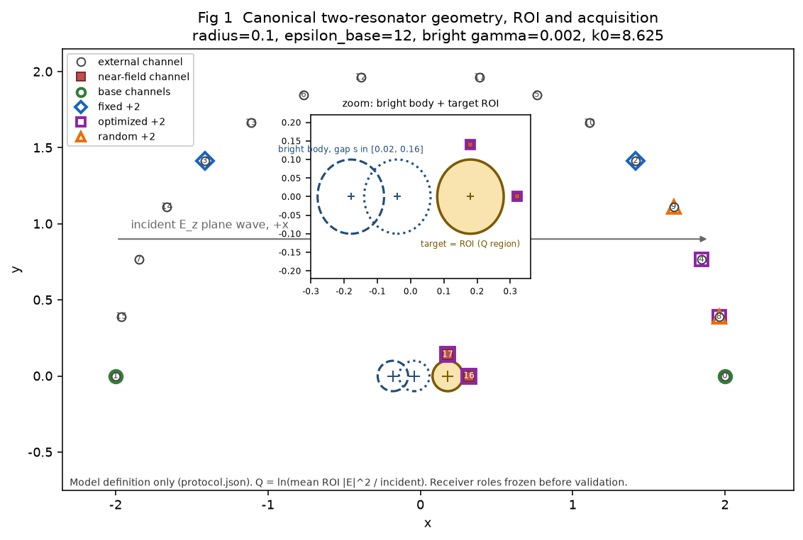

## fig02_frequency_spectrum

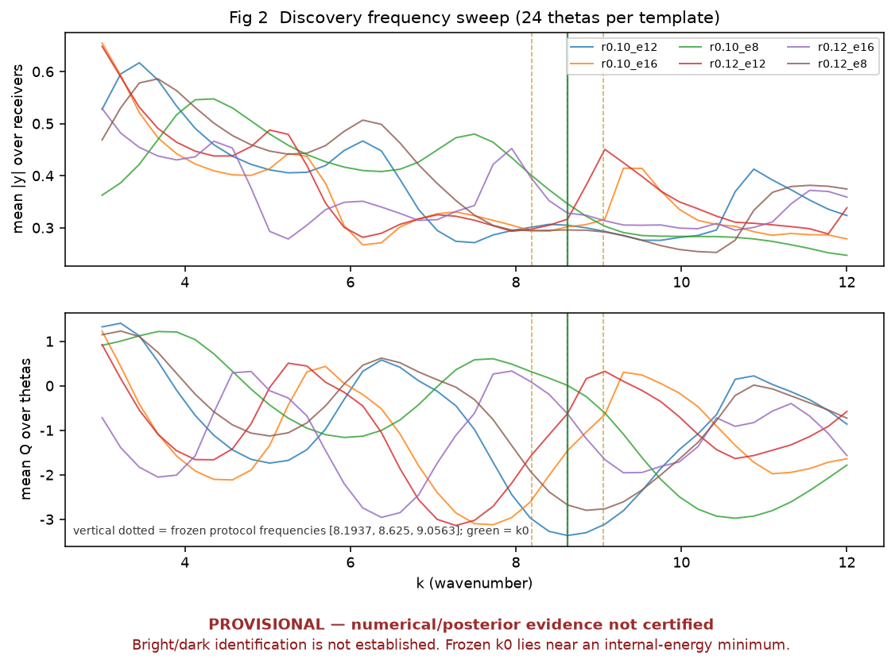

## fig03_mode_diagnostic

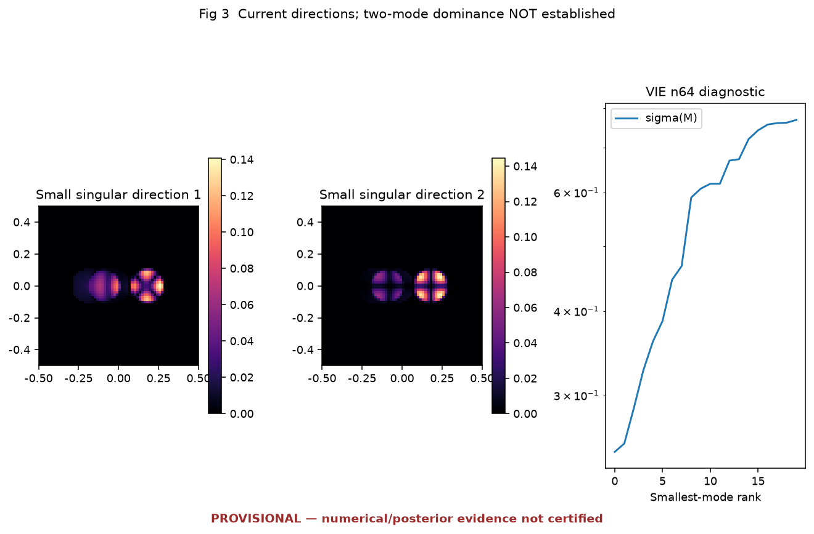

## fig04_parameter_map

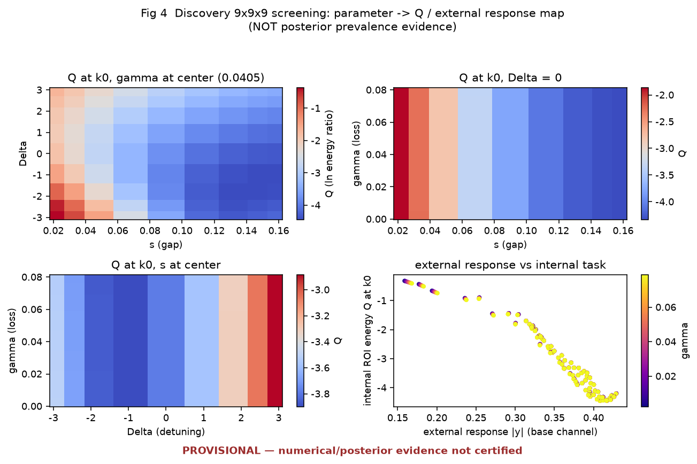

## fig05_parameter_posterior

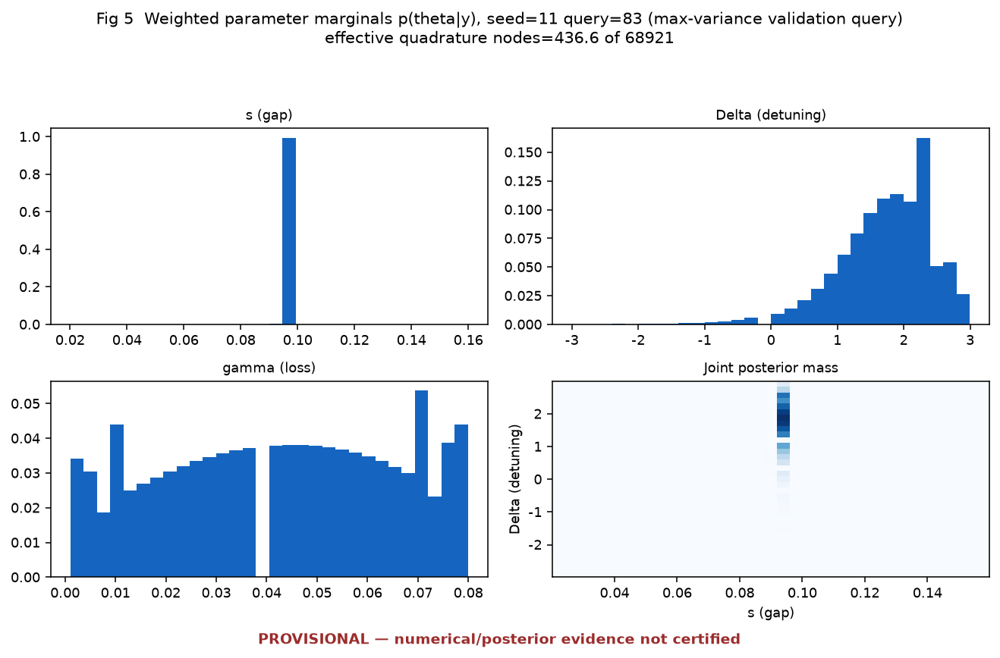

## fig06_Q_posterior

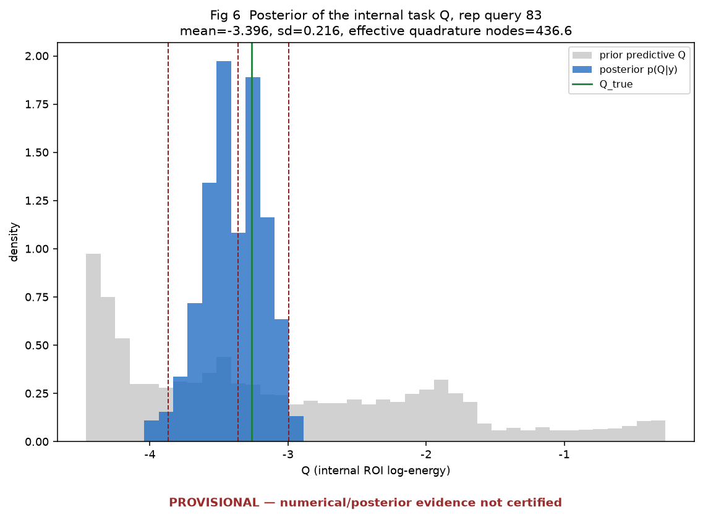

## fig07_material_field_pair

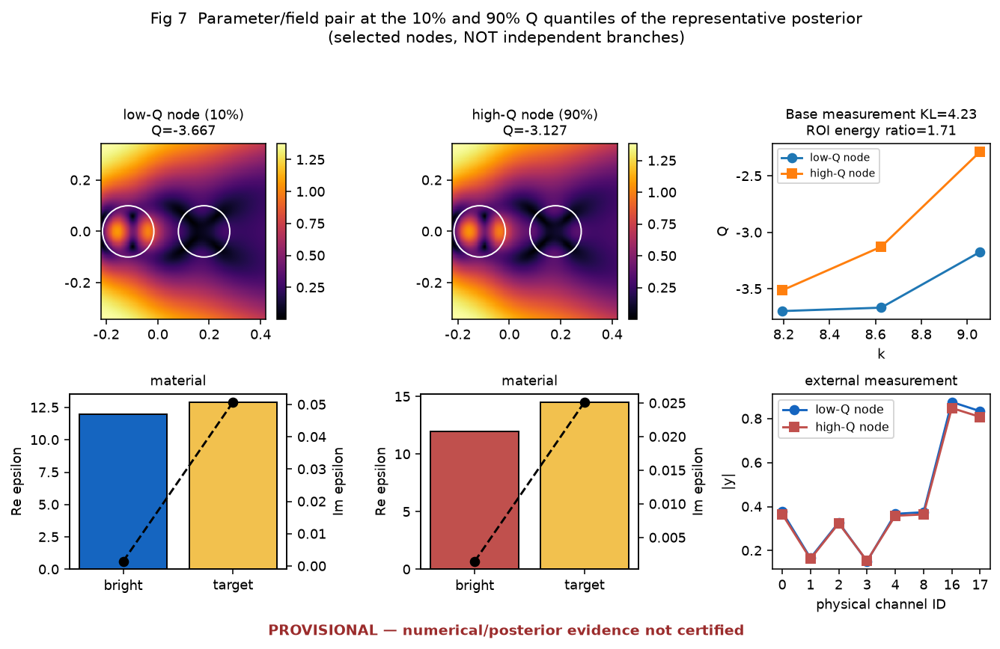

## fig08_query_sd_distribution

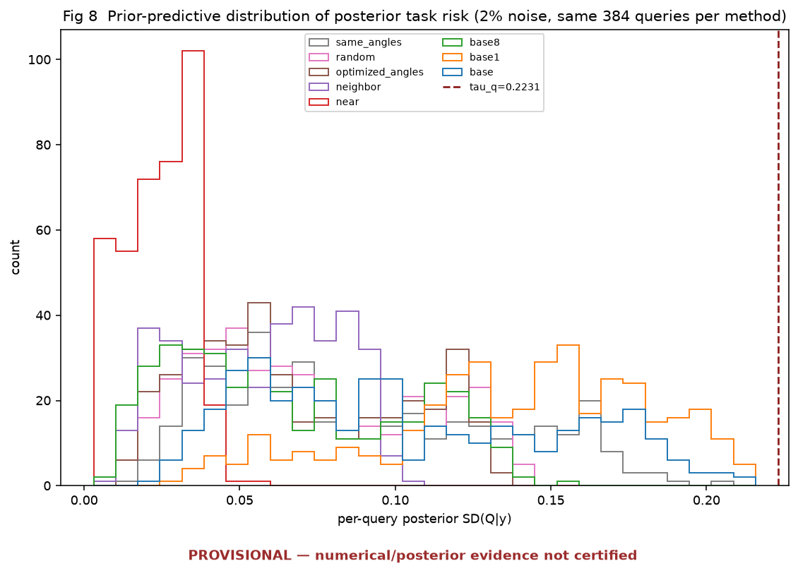

## fig09_risk_comparison

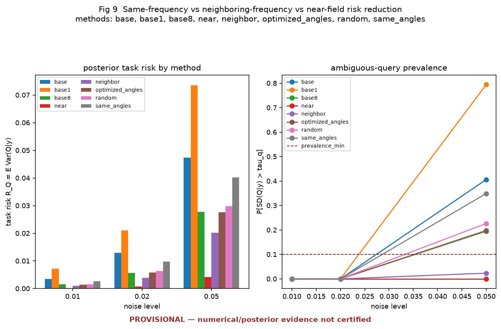

## fig10_coupling_ablation

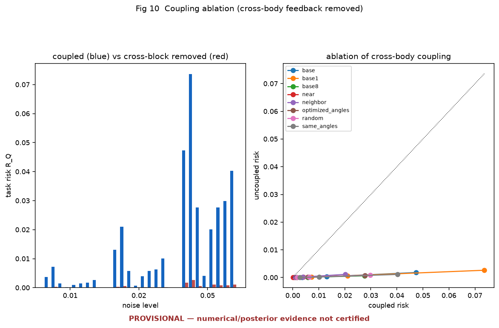

## fig11_modal_decomposition

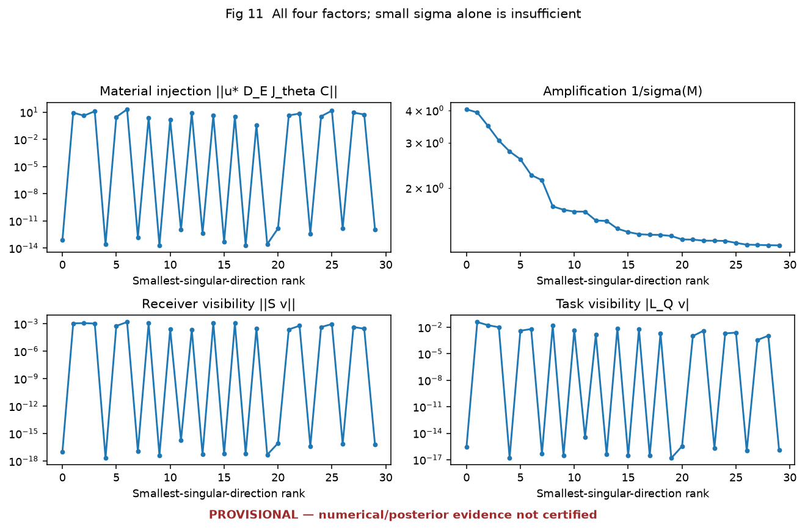
